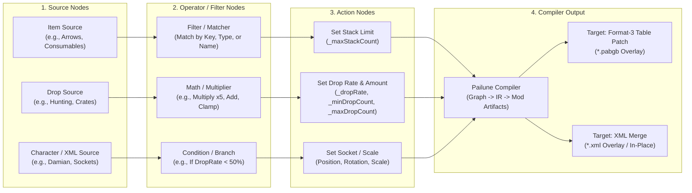
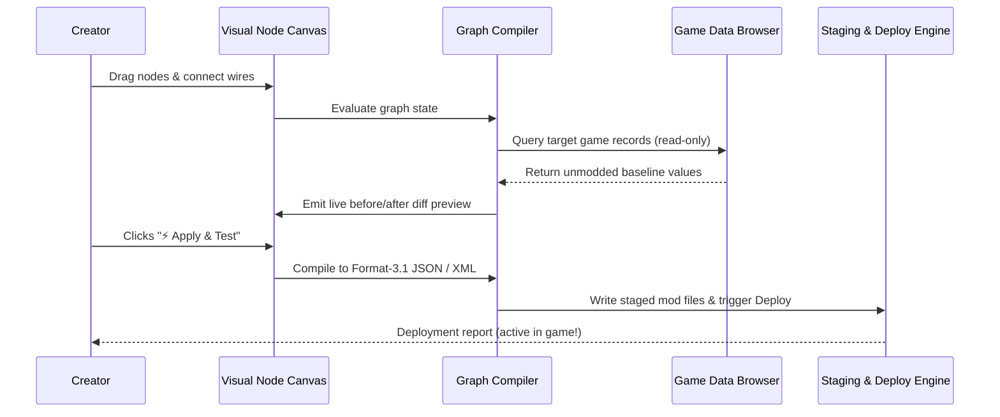

# Visual Mod Creator: Architecture & Implementation Plan

This document establishes the architecture, UX workflow, and implementation plan for **Pailune's Visual Mod Creator** — a node-based, no-code modding studio embedded directly inside Pailune for Crimson Desert.

---

## 1. Vision & Core Philosophy

1. **No-Code for Non-Tech Creators**:
   Players who do not know JSON syntax, hexadecimal offsets, or binary table structures should be able to craft polished, game-ready mods through an intuitive visual canvas.
2. **Deterministic Multi-Target Compilation**:
   The visual node graph does not run an unverified interpreter at runtime; instead, it compiles cleanly down to Pailune's verified mod formats:
   - **Format 3.1 JSON Table Patches** (`.field.json` deployed via PAZ overlay `0100`).
   - **XML Patch / Merge Rules** (deployed via overlay or in-place redirection).
   - **Asset / Audio Redirection** (deployed via in-place group index patching).
   - **ASI Scaffolding** (for advanced runtime memory hooks).
3. **Interactive Verification & Live Preview**:
   Changes are previewed live against the real game data tables (powered by `src/tables/browser.rs`), showing real "Before vs After" diffs prior to deployment.
4. **Instant Test Loop**:
   One-click `⚡ Apply` and `▶ Launch` allow instant verification in-game, with atomic undo.

---

## 2. Node Graph Architecture



### Node Category Hierarchy

#### Category 1: Source Nodes (Inputs)
- **Item Query Node**: Pick items from a dropdown or search bar populated by `iteminfo` (e.g. `Pyeonjeon_Arrow`, `Meat_II`, `Deer_Leather`, or wildcard `*`).
- **Drop Table Source**: Select loot tables from `dropsetinfo` (e.g. `DropSet_Middle_Animal_Common`, `DropSet_BoxBarrel_01`, `DropSet_Pot_01`).
- **Wanted / Price Source**: Select bounty entries or price indices from `wantedinfo`.
- **Socket / Character Descriptor**: Browse character XML files and bone socket hierarchies.

#### Category 2: Transformation & Operator Nodes
- **Multiplier Node**: Multiplies numeric fields (e.g. `x 2`, `x 5`, `x 10`, `x 100`).
- **Add / Offset Node**: Increments or decrements values.
- **Clamp / Boundary Node**: Enforces minimum and maximum limits (e.g. minimum drop count = 10, maximum = 50).
- **Condition / Filter Node**: Predicate matching (e.g., only items where `_itemType == Consumable`).
- **Color / Vector Node**: 3D vector and RGB color pickers for visual parameters.

#### Category 3: Action / Mutation Nodes
- **Set Stack Size**: Sets `_maxStackCount` in `iteminfo`.
- **Set Drop Rate**: Sets `_dropRate` in `DropSetInfo` (slider 0% to 100%, where 100% = 1,000,000).
- **Set Loot Yield**: Sets `_minDropCount` and `_maxDropCount` on drop entries.
- **Set Bounty / Price**: Modifies reward coins or shop prices.
- **Adjust Bone Socket**: Sets relative position, rotation, or scale on character socket XMLs.

#### Category 4: Mod Output Node
- **Mod Configuration**: Sets Mod Title, Author, Version, Description, and Category.
- **Compiler Target**: Emits the generated mod folder into Pailune's staging directory.

---

## 3. Serialization & Project Structure

Visual mod projects are stored as ordinary staged mods inside `~/.local/share/pailune/staging/<mod_name>/`:

```
staging/<mod_name>/
├── modinfo.json            <- Standard Pailune metadata
├── graph.json              <- Persisted node graph (nodes, positions, connections)
├── patches/
│   └── *.field.json        <- Compiled format-3 table patches
├── descriptors/
│   └── *.xml               <- Compiled XML patches
└── README.md               <- Auto-generated documentation
```

### Graph JSON Schema (`graph.json`)
```json
{
  "format": "pailune_graph_v1",
  "title": "Mega Hunting & Stacks",
  "nodes": [
    {
      "id": "node_1",
      "type": "item_query",
      "pos": [120.0, 180.0],
      "properties": {
        "item_name": "Arrow",
        "match_mode": "name_contains"
      }
    },
    {
      "id": "node_2",
      "type": "modify_stack_size",
      "pos": [450.0, 180.0],
      "properties": {
        "new_stack_limit": 999
      }
    }
  ],
  "connections": [
    {
      "from_node": "node_1",
      "from_socket": "item_out",
      "to_node": "node_2",
      "to_socket": "item_in"
    }
  ]
}
```

---

## 4. Compiler Pipeline (Graph $\to$ Mod Artifacts)



### Step-by-Step Compilation Steps:
1. **Topological Sort**: Traverses connected nodes from Sources to Targets to ensure dependency order.
2. **Validation**: Checks for unlinked mandatory sockets, division by zero, or out-of-range integer values.
3. **Target Resolution**: Maps visual node mutations to underlying table files and field paths:
   - `Item Query -> Modify Stack Size` $\to$ `iteminfo.pabgb` with `set _maxStackCount`.
   - `Drop Source -> Multiplier -> Set Drop Yield` $\to$ `dropsetinfo.pabgb` with `_dropInfoList[*]._dropRate`, `_minDropCount`, `_maxDropCount`.
4. **Artifact Generation**: Writes clean, human-readable format-3 JSON files (`.field.json`) and XML descriptors into the mod folder.
5. **Auto-Readme Generation**: Automatically creates a Markdown `README.md` listing every altered parameter and multiplier for publishing to Nexus Mods.

---

## 5. UI / UX Design in Pailune

### A. Dedicated "Mod Creator" Tab in Navigation Bar
Added alongside `Mods`, `Saves`, `Data Browser`, `Profiles`, `Nexus`, `Log`, `Settings`:
```
[ Mods ] [ Saves ] [ Data Browser ] [ Visual Creator ] [ Profiles ] [ Nexus ] ...
```

### B. Canvas Layout
- **Toolbar (Top)**:
  - `+ Add Node` dropdown menu (categorized by function).
  - `Templates` library (e.g., *10x Loot Multiplier*, *Max Arrow Stacks*, *Durability Overhaul*).
  - `⚡ Apply Mod` (instantly writes and links into the game).
  - `▶ Test (Apply & Launch)` (launches Crimson Desert via Proton).
  - `📦 Export to ZIP` (bundles mod for Nexus).
- **Canvas (Center)**:
  - Infinite pannable and zoomable grid with smooth bezier connection wires.
  - Sockets color-coded by type:
    - 🔵 Blue: Item / Entity Reference
    - 🟢 Green: Numeric Value / Multiplier
    - 🟡 Yellow: Condition / Boolean
    - 🟣 Purple: Character / Socket Descriptor
- **Inspector & Diff Preview (Right Panel)**:
  - Shows details of the currently selected node.
  - Live Diff: Displays real game table records impacted by the graph and their exact before/after values.

---

## 6. Template Library for Instant Mod Creation

To make Pailune instantly rewarding for first-time modders, the Visual Creator will ship with **One-Click Starter Templates**:

1. **"Mega Stacks" Template**:
   - Pre-wired graph targeting ammunition, potions, and food items, with a single slider controlling max stack count (100 $\to$ 999).
2. **"Loot & Hunting Bounty" Template**:
   - Pre-wired graph for animal hunting and monster loot, with sliders for drop rate (0–100%) and meat/leather yield multipliers.
3. **"Treasure & Crate Rewards" Template**:
   - Boosts loot rewards from breakable pots, wooden barrels, and locked treasure chests.
4. **"Accessory & Equipment Attacher" Template**:
   - Attaches cosmetic models and weapons to character bone sockets with visual 3D position/rotation sliders.

---

## 7. Phased Implementation Roadmap

### Phase 1: Core Node Engine & Data Structures
- Define `Graph`, `Node`, `Socket`, `Connection`, and `NodeType` structures.
- Implement JSON serialization/deserialization for `graph.json`.
- Implement `GraphCompiler`: transforms node graphs into `FieldPatch` format-3 intents and XML patch entries.

### Phase 2: Canvas GUI & Node Rendering in egui
- Implement custom interactive node canvas in `src/ui/views/visual_editor/`:
  - Canvas pan, zoom, grid rendering.
  - Draggable node frames with header titles and custom controls (sliders, dropdowns, input boxes).
  - Bezier curve connection routing with connection snapping and type validation.

### Phase 3: Integration with Game Data & Live Preview
- Connect node queries to `src/tables/browser.rs` to allow auto-completing item names and drop tables directly from installed game files.
- Live diff preview panel showing affected records and modified fields.

### Phase 4: Staging, Testing Loop & One-Click Export
- Wire `⚡ Apply` and `▶ Launch` buttons to Pailune's job runner.
- Wire `📦 Export to ZIP` reusing `src/mod_engine/package.rs` to output complete distribution archives with auto-bumped versions and generated readmes.
- Add starter templates (*Mega Stacks*, *Loot Bounty*, *Crate Coin Pouch*).
