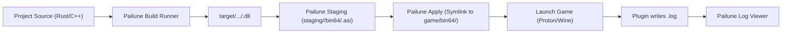

# Research & Architecture: ASI Plugin Creation for Crimson Desert (B-17)

## 1. Overview & Execution Context

Crimson Desert's engine is built on data-driven design (sequences, tables, gimmicks, XML) without an internal scripting layer (see [script-bridge.md](script-bridge.md)). Gameplay mechanics that are hardcoded into the executable binary (such as interaction hold times, camera FOV constraints, physics limits, and custom UI hooks) are modified through native **ASI plugins** (dynamic libraries loaded by the game process).

Pailune acts as both a mod manager and a modding tool (decision D-13). For native ASI plugins, Pailune provides the development harness: scaffolding, cross-compilation toolchains from Linux, automated staging, deployment into `bin64/`, log monitoring, and release packaging. In accordance with safety and legal guidelines, Pailune provides the tooling and harnesses; specific function hooks and pattern offsets are authored by mod developers.

---

## 2. The ASI Loader Contract

### Loader Mechanism
* On Windows and Linux/Proton, the game is launched through `bin64/BlackSpace64.exe`.
* The community utilizes proxy DLL loaders such as the **Ultimate ASI Loader** (`winmm.dll`, `version.dll`, or `dinput8.dll`) placed directly in `bin64/`.
* When `BlackSpace64.exe` loads its dependencies via `LoadLibraryW`, the proxy DLL initializes first and scans for plugins in:
  1. `bin64/*.asi` and `bin64/*.dll`
  2. `bin64/plugins/*.asi`
  3. The root game directory

### Entry Point & Threading Rules
1. **DLL Entry (`DllMain`)**:
   ```c
   BOOL WINAPI DllMain(HINSTANCE hinstDLL, DWORD fdwReason, LPVOID lpvReserved);
   ```
2. **Avoiding the Windows Loader Lock**:
   * Windows holds the OS loader lock during `DllMain`. Calling synchronization primitives, `LoadLibrary`, or heavy I/O within `DLL_PROCESS_ATTACH` will deadlock the process.
   * **Rule**: When `fdwReason == DLL_PROCESS_ATTACH`, the plugin must only dispatch a background thread (e.g. `std::thread::spawn` in Rust or `CreateThread` in C++) and return `TRUE` immediately.
3. **Optional Exports**:
   * Certain loaders query plugin metadata or lifecycle hooks such as `extern "C" __declspec(dllexport) void InitializeASI(void);`. The primary attachment remains `DLL_PROCESS_ATTACH`.

---

## 3. Toolchains & Cross-Compilation from Linux

Most Pailune users develop on Linux (Steam Deck, Arch, Fedora, Ubuntu) targeting Crimson Desert running under Proton. Pailune supports cross-compiling native Windows x64 DLLs directly from Linux:

### Rust `cdylib` (Recommended)
* **Target**: `x86_64-pc-windows-gnu` (MinGW) or `x86_64-pc-windows-msvc`.
* **Crate Type**: `crate-type = ["cdylib"]`.
* **Linker Configuration**: Static CRT linking (`-C target-feature=+crt-static`) to avoid runtime dependency on foreign MinGW DLLs (`libgcc_s_seh-1.dll`, `libwinpthread-1.dll`).
* **Toolchain Requirements**:
  * `rustup target add x86_64-pc-windows-gnu`
  * Host package: `x86_64-w64-mingw32-gcc` (for linking).

### C++ MinGW
* **Compiler**: `x86_64-w64-mingw32-g++` (available on all major Linux distributions via package manager).
* **Flags**: `-shared -static -static-libgcc -static-libstdc++ -O3 -std=c++20`.

---

## 4. Pattern Scanning & Memory Patching Contract

Because game updates shift function addresses, robust plugins do not use hardcoded memory addresses. Instead, they scan the executable memory for unique byte signatures (IDA-style patterns):

1. **Module Base Resolution**:
   * `GetModuleHandleA(NULL)` retrieves the base address of `BlackSpace64.exe`.
   * Parse DOS and NT headers (`IMAGE_DOS_HEADER`, `IMAGE_NT_HEADERS`) to find the `.text` code section range (`VirtualAddress`, `SizeOfRawData`).
2. **Signature Matching**:
   * Byte signatures support wildcards (`?` or `??`), e.g.:
     `48 89 5C 24 ? 48 89 74 24 ? 57 48 83 EC 20`
3. **Memory Protection (`VirtualProtect`)**:
   * Executable code pages are marked `PAGE_EXECUTE_READ`.
   * To write inline patches (NOPs, value replacements, or 5-byte/14-byte JMP detours), callers must call `VirtualProtect(addr, size, PAGE_EXECUTE_READWRITE, &old)` and restore `old` after writing.

---

## 5. Configuration & Logging

* **Configuration**:
  * Stored in `<plugin_name>.ini` alongside the `.asi` in `bin64/`.
  * Read via standard Windows `GetPrivateProfileStringA` / `GetPrivateProfileIntA` or a cross-platform INI parser.
* **Logging**:
  * Written to `<plugin_name>.log` in `bin64/`.
  * Pailune surfaces plugin logs directly inside the Mod Details and Application Log tabs.

---

## 6. Build & Deploy Loop


