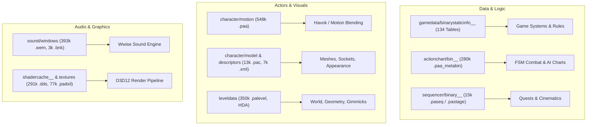

# BlackSpace Engine Architecture & Modding Surfaces

This document details the inner architecture of the **BlackSpace Engine** (Pearl Abyss' proprietary engine powering Crimson Desert), reverse-engineered and measured read-only on build 2.3.2 across the game's 36 pack groups (2,056,434 indexed files, 152 GB).

---

## 1. Engine Archive & Packaging Layer

The game streams all data from 36 archive groups (`0000` through `0035`), registered in `meta/0.papgt` (Pack Archive Pack Group Table) and `meta/0.pathc` (Texture Chunk Header Cache).

| Component | Format / Layout | Purpose | Modding Route |
|:---|:---|:---|:---|
| **Group Indices** | `NNNN/0.pamt` | Hash-verified name tries resolving virtual paths (`/`-separated) to `(paz_index, offset, stored_size, orig_size, flags)`. | Modified in-place via `0.pamt` rewrite & `0.papgt` CRC sync (D-14). |
| **Data Archives** | `NNNN/k.paz` | 16-byte aligned binary chunks. Flag bits define compression (LZ4, ZSTD, DDS-Partial) and ChaCha20 encryption. | Overlaid via high-index pack group `0100` (A-01) or appended as custom `<k>.paz`. |
| **Texture Cache** | `meta/0.pathc` | Lookup table storing raw DDS mip headers for streaming textures (chunk splitting). | Overlaid via high-index group or patched. |
| **Executable** | `bin64/CrimsonDesert.exe` | 384 MB monolithic x86_64 binary. Contains reflection string tables, Wwise sound engine, Havok animation, Direct3D 12 Agility SDK, DLSS/FSR3/XeSS. | Hooked via Ultimate ASI Loader (`winmm.dll`) and `.asi` plugins (B-17). |

---

## 2. File Systems & Engine Subsystems

Analysis of the 2,056,434 indexed files reveals the engine's primary subsystem boundaries:

### Breakdown of File Types:

1. **Animation & Motion (`character/motion/`, 548,409 `.paa` files)**:
   - Skeletal animation curves, root motion data, and bone transform streams.
   - Paired with Havok physics bindings (`.hkx`, 60,324 files) and `.motionblending` rules.

2. **Action Charts (`actionchart/bin__/`, 280,011 `.paa_metabin` files)**:
   - The engine's core behavioral graph and finite-state machine (FSM) format.
   - Dictates skill activation, combo branching, stagger states, dodge windows, weapon attack animations, and NPC reaction behavior.

3. **Data Tables (`gamedata/binarystaticinfo__/bin/`, 134 tables)**:
   - Central database for game parameters (`ItemInfo`, `DropSetInfo`, `Skill`, `WantedInfo`, `CraftToolInfo`, `CategoryInfo`, etc.).
   - Header index (`*.staticinfoheader`) + binary record stream (`*.staticinfobody`).

4. **Audio Engine (`sound/windows/`, 390,308 `.wem` files, 3,288 `.bnk` files)**:
   - Audiokinetic Wwise pipeline. Dialogue, ambient soundscapes, weapon impacts, music.
   - Deployed seamlessly via Pailune's in-place redirection route without repacking massive archives.

5. **Model Properties & Meshes (`character/modelproperty/`, `character/model/`)**:
   - Multi-section `.pac` mesh archives (LZ4 compressed with 80-byte `PAR ` headers).
   - `.pami` (mesh instances) and `.pam` (model structures).

6. **Descriptors & Socket Configuration (`character/descriptors/`, 7,598 `.xml` files)**:
   - Bone sockets (`phw_damian_01.pab.sockets.xml`), character descriptions (`phm_description_player_kliff.xml`), fracture configs (`*_fractureconfig.xml`), and color palettes.

---

## 3. Modding Surfaces & Capabilities

| Target System | What It Controls | Best Modding Mechanism in Pailune |
|:---|:---|:---|
| **Item & Economy Stats** | Max stacks, durability, prices, crafting recipes, shop inventories. | **Format 3.1 JSON Table Patches** (`iteminfo.pabgb`, `wantedinfo.pabgb`). |
| **Drop Rates & Loot** | Hunting amounts, fish drops, barrel/chest rewards, coin pouches. | **Format 3.1 JSON Table Patches** (`dropsetinfo.pabgb` with nested `_dropInfoList`). |
| **Combat & Skills** | Cooldowns, damage multipliers, action speeds, stamina costs. | **Format 3.1 JSON Table Patches** (`skill.pabgb`) & **Action Chart Overlays**. |
| **Character Aesthetics** | Sockets, attachment points, clothing fit, character presets. | **XML Patch / Merge** (`character/descriptors/**/*.xml`) + In-place route. |
| **Textures & Shaders** | UI icons, armor recolors, environmental textures. | **DDS Texture Overlays** in high-index group `0100`. |
| **Sound & Voiceovers** | Custom music, sound effects, voice lines. | **In-Place `.wem` / `.bnk` audio redirection** (D-14). |
| **Runtime Code / Memory** | Camera FOV, custom keybinds, god mode, engine hooks. | **C++ / Rust ASI Plugins** loaded via `winmm.dll` (B-17 / D-15). |
